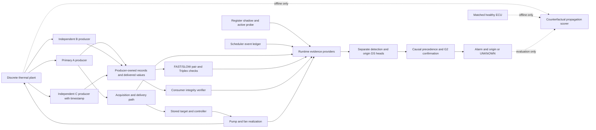

# 06 — Authentic figure data and redraw specifications

Evidence labels used throughout: **VERIFIED FROM SOURCE** (literal implemented behavior); **VERIFIED FROM EXPERIMENT ARTIFACT** (recorded outcomes/protocol); **DERIVED MATHEMATICALLY FROM VERIFIED SOURCE** (algebra or deterministic accounting, not a new experiment); **NOT RECOVERABLE / REQUIRES CONFIRMATION** (missing/limited evidence). Source paths are repository-relative unless explicitly absolute. Line numbers refer to the hashes in 07, not an assumed future HEAD.

Every panel below is **VERIFIED FROM EXPERIMENT ARTIFACT** unless marked source-derived. `data/copy_manifest.json` records byte-identical source-to-package copies and hashes. Never synthesize missing individual observations from summary rates. No new figure is drawn here: this is content and traceability for journal redraws.

## 1. Full cross-layer architecture (VERIFIED FROM SOURCE)

Do not draw hidden plant truth feeding DS/RF or an injected fault label feeding DI. M2 is an active memory transaction, not a pump excitation. Draw producer ownership as an assumed trust boundary, not a verified secure enclave. Numerical timing/order comes from01/02. Sources: scheduler.c, generated adapter.c, runtime_observation.h, digital_sensor_integrity.c, triplex_consistency.c; exact references in07.

## 2. Fault–observable and gap–witness mapping

**VERIFIED FROM SOURCE / DERIVED MATHEMATICALLY FROM VERIFIED SOURCE.** Reuse existing matrix in `docs/cross_layer_observability_model.md` with YES/PARTIAL/NO/CONTEXT-DEPENDENT. Show: dormant bit→active probe only if overlapping; A+B disagreement blind spot→independent C conditional on failure domains; post-conversion weak step→protected producer witness when sampled; brief uncaptured pulse→still sampling-limited; idle pump→still context-limited. Do not draw an arrow claiming CRC observes physical sensor degradation or C always identifies a faulty member. Γ trace-effect and healthy-trace-set distinguishability are distinct.

## 3. Development ablations, separate panels and denominators

Use `digital_integrity_development__summary.csv`, filter partition=VALIDATION: A0 1014/1200, A1 1103/1200, A2 1125/1200; each55/1200 benign, plant583/639→639/639→639/639. Frozen SVM default1125/1200 and0/1200 benign. SEEN90 is a separate targeted panel:0→82→82 out of90;82 are integrity-observed, eight uncaptured; do not call it unseen.

Use `benign_alarm_development__summary.csv`, filter VALIDATION: original/refined1124/1200 each; benign49/2400→0/2400; plant641/641 each. Never combine that49 with historical55 or present G2 as the cause of the A1/A2 detection gain. Historical retained Triplex summaries/retentions are separate panels with their own denominators and failed-retention notes.

## 4. Primary final unseen per-origin detection

Use `integrity_final_unseen__subgroups.csv` with method=A2 and the five origin subgroup names; denominator240 each:235,240,240,232,177. Overall1124/1200=93.6667%, Wilson95[.921444350587608,.9491021755526701]; benign0/600; plant645/645. A0 and SVM figures must use this same primary cohort only. Primary first-localized1124/1124 with no wrong origins; runtime1851 UNKNOWN among437542 fault alarm samples. Do not substitute origin-RF's1858/437563, which is a different cohort.

## 5. Residual missed-fault taxonomy

Use authentic primary `misses.csv` filtered A2 and row-level flags:63 unexcited pump,8 uncaptured50-ms pulses,5 dormant/no-active-probe stuck bits =76. Plot count76 as denominator, not1200 unless explicitly changing axis interpretation. All76 lack recorded plant manifestation. Source-derived categories are conditional structural63 and temporal13; no separately established classifier-only/common-witness category. Do not assign observed counts to unmodeled physical/common-witness faults.

## 6. Ten-method qualified comparison

Use `ieee_multibaseline__summary.csv`, its per-origin/localization/paired CSVs and selection.json. Each method has1200 faults+600 benign and645 plant-propagating faults. Detection counts in table order: OR1124,WS892,PlainDS1124,EWMA1078,CUSUM1094,LR1124,RF1129,SVM1124,A01021,CLOVER1124. OR/PlainDS/A0 each7 benign alarms; others0. Classical strength reduction and41-feature ML are qualified strata, A0 is architecture ablation. Binary RF's1129 does not imply a new physical observable; inspect recorded RF-only audit before interpretation. Do not hide this negative comparison. Use original paired tests/Holm-adjusted columns, not independent-binomial tests.

## 7. Origin-aware RF comparison and authentic confusion

Use **`ieee_origin_rf__first_confusion.csv`**, copied byte-for-byte. Preserve `cohort` selector: ALL_CASES_FIRST includes1800 cases; COMMON_DETECTED_FIRST includes1124 detected faults per method. In ALL_CASES_FIRST, NORMAL column for a faulty row means **no alarm**, not UNKNOWN localization. UNKNOWN is a detected alarm with abstention. Do not add rows across the two selectors or the two methods. `runtime_confusion.csv` has different sample denominators and is not a first-alarm matrix.

CLOVER and origin-RF each1124/1200 with0/600 benign and645/645 plant. First origins agree/correct on1124 common detections. Runtime CLOVER:437563 alarms,435705 correctly localized,1858 UNKNOWN; RF:445895 alarms,445861 correctly localized,34 UNKNOWN; both zero wrong origins. Different alarm supports mean these raw totals are not directly paired localization accuracy. Use `common_alarm_localization.csv` and `paired_first_origin_common.csv` for matched supports. RF detects70 cases100ms earlier,1054 tie; verify source report before labeling latency deltas. Frozen SVM is binary and has no localization panel.

## 8. Robustness and actuator excitation

Use `frozen_robustness__summary.csv`, per_origin.csv and variation_from_final.csv; profile selector is `condition` (inspect original header). Each profile300fault+100benign and60/origin. A2=SVM: P0 281, P1 255, P2 288, P3 281, P4 281, P5 288 detections. Plant denominators170,37,192,187,170,227, all detected; benign0/100 throughout. Pooled1674/1800 and983/983 plant,0/600 benign. A2 actuator detections44,18,51,44,44,51 out of60. The evidence attributes all matched-template detection changes to excitation, not new classifier-only failures. Label P4 fixed acquisition phase—not scheduler jitter. Original final unseen is a separate reference line, not extra pooled cases.

## 9. Native ROM/RAM component breakdown

Use `native_memory_footprint__footprint.json`/ratios.json for matched B pipelines, not the older combined shared-library sizes. Components: method text, constants/model, unwind metadata, static data/BSS, observed touched stack, with alignment separately. Model/struct allocations are subsets of sections and must not be stacked again. RF A is a distinct precomputed-evidence boundary; never compare it unqualified to CLOVER B. Do not label host ELF size as MCU flash. Native-resource timing.json is a different build and only supports its own host timing panel.

## 10. RTL block diagram

**VERIFIED FROM SOURCE / VERIFIED FROM EXPERIMENT ARTIFACT.** Draw producer channel/bits/time → sequence increment + CRC → five32-bit protected registers+valid; trusted transform updates bits/tag only; consumer/delivered fields → identity/value, sequence/time and CRC comparison →3-bit causes and UNAVAILABLE/PASS/FAIL. No consumer→protected write edge. One161-bit bank/module, combinational verification. Show4,556 cells/161FF, library area7,425.656 and explicitly constrained pre-layout timing separately from architecture. Source RTL and record/statistics/timing setup in05; no full ECU synthesis diagram.

## Authentic small data inventory

| Original | Packaged | SHA-256 |
|---|---|---|
| `results/digital_integrity_development/summary.csv` | `data/digital_integrity_development__summary.csv` | `3a0f5ecaa9abdf4ba7d3da98ba1afd1fdff7b0704ca0c758bf74cd010b229441` |
| `results/digital_integrity_development/localization.csv` | `data/digital_integrity_development__localization.csv` | `61c3a60794a91a155de8f47c04cb9b3171cf62a529cb04b0c6059718f622c069` |
| `results/digital_integrity_development/subgroup_summary.csv` | `data/digital_integrity_development__subgroup_summary.csv` | `2b711e786c245135016e6897c8ac5ff311a4568df5d0ca3703b93e205cbdd9a8` |
| `results/digital_integrity_development/paired_comparison.csv` | `data/digital_integrity_development__paired_comparison.csv` | `7fc98ebb4c36df2a4108142383b807657576d8f6c477fdace45b8c6075434e45` |
| `results/digital_integrity_development/failure_mode_tests.csv` | `data/digital_integrity_development__failure_mode_tests.csv` | `44e5d22fba5f8c6ed6fbb7fde97dc73111132101a66c13eb8af7f710ccb06cf2` |
| `results/digital_integrity_development/previous_90_audit.csv` | `data/digital_integrity_development__previous_90_audit.csv` | `240ced715faace4b887c2bb6f73436ab2d1bb26fec40c50dc0ca7e4a62f4db9d` |
| `results/digital_integrity_development/svm_selection.json` | `data/digital_integrity_development__svm_selection.json` | `1180210f23532bda29d65c97729d907357771728e81cd7fd414e71cd70d8d5bf` |
| `results/benign_alarm_development/summary.csv` | `data/benign_alarm_development__summary.csv` | `26b3f79d2b94c0f7078c0634094f7042434cf1127b7ca2a784f72dfa8dabcb1c` |
| `results/benign_alarm_development/localization.csv` | `data/benign_alarm_development__localization.csv` | `e67c9b5493471dcb2a306f1f1e39c020cd5ee1c56881a3abddcdcd68f975aed2` |
| `results/benign_alarm_development/per_origin.csv` | `data/benign_alarm_development__per_origin.csv` | `8c85f7cbe56504e73d503b83f846b3577c106148dd9c21e20488da921a2123a8` |
| `results/benign_alarm_development/paired.csv` | `data/benign_alarm_development__paired.csv` | `320890dce507a22d1bbbf7074234b13c8ba67d075e677d59cd150e87ef7d0645` |
| `results/benign_alarm_development/selection.json` | `data/benign_alarm_development__selection.json` | `3667a145edb9f48b34d444dbb9b22b5feb8082cd2319393fa6841ec696c50dbf` |
| `results/integrity_final_unseen/summary.csv` | `data/integrity_final_unseen__summary.csv` | `fc08b5840477a9e388a72a1908699f65936fff645e7cb26603e6886c6cf01b0d` |
| `results/integrity_final_unseen/localization.csv` | `data/integrity_final_unseen__localization.csv` | `06f07b58bf19fda798b17aed3e7594656947c8c7bd8b2f17f22f6c06fcd994c6` |
| `results/integrity_final_unseen/subgroups.csv` | `data/integrity_final_unseen__subgroups.csv` | `e8ad47b7d1412cb86a33723a66598be662ba87c23a241607616144e7b5f325c4` |
| `results/integrity_final_unseen/paired.csv` | `data/integrity_final_unseen__paired.csv` | `eb68c345569b282cbc0ac736a827b511ff675f79c0e2f5b471da6ce85ab92c3c` |
| `results/integrity_final_unseen/confusion.csv` | `data/integrity_final_unseen__confusion.csv` | `b024b351511b7de85588898ceaee3f524e920136af2415562af89dc07f959b13` |
| `results/frozen_robustness/summary.csv` | `data/frozen_robustness__summary.csv` | `5627c470254ce38e97f5ae87f09e5a303caee62cdab6d9dd37e1f98a3e3a7714` |
| `results/frozen_robustness/localization.csv` | `data/frozen_robustness__localization.csv` | `b6155549c5ff00035a91e96f7f50c5a9aa38926da9012a5acd265d5ffed765a3` |
| `results/frozen_robustness/per_origin.csv` | `data/frozen_robustness__per_origin.csv` | `a857941fa08a3410aa1cc8cff3bdb4e8352421c67bc9b9cf3a3130f0acaa7b81` |
| `results/frozen_robustness/paired.csv` | `data/frozen_robustness__paired.csv` | `0a3ddba098ef12aa046613f7903fb7d982cdc01a861642e18d663942114f3ae5` |
| `results/frozen_robustness/variation_from_final.csv` | `data/frozen_robustness__variation_from_final.csv` | `04aef648a24bf08e59f18edb6933e1005fda587e770ef7a67ffc081c18dab69e` |
| `results/ieee_multibaseline/summary.csv` | `data/ieee_multibaseline__summary.csv` | `c2f5ec71e815624c302f3e5f837f1c1882ca1122a40afb2efbe9817e17409cd9` |
| `results/ieee_multibaseline/localization.csv` | `data/ieee_multibaseline__localization.csv` | `a90a46c2ef586591190ac32808efe374d9dd3b2eb2feed0a3236470bdd363e9f` |
| `results/ieee_multibaseline/per_origin.csv` | `data/ieee_multibaseline__per_origin.csv` | `461c9d2a3c3a62133c8cb272d5423628659c0b8107914bfd00330c4ac84e49c6` |
| `results/ieee_multibaseline/subgroups.csv` | `data/ieee_multibaseline__subgroups.csv` | `9043789dbe82e9230d94ed89283831eee2499327f568d724ff9a83a5987bd7ae` |
| `results/ieee_multibaseline/paired.csv` | `data/ieee_multibaseline__paired.csv` | `37e981891d0262d5897f8fbc5a296dc9ed64d822ff0a81b4d528a239d9230f2e` |
| `results/ieee_multibaseline/selection.json` | `data/ieee_multibaseline__selection.json` | `68dc951b3f1b181790fa43fa8bef951f752a074e98163f96f5ba8e652c5cac9a` |
| `results/ieee_multibaseline/training_record.json` | `data/ieee_multibaseline__training_record.json` | `5549f166255535dda343e8e1625c2a960234ff827337cb699232f93275405d46` |
| `results/ieee_origin_rf/summary.csv` | `data/ieee_origin_rf__summary.csv` | `c665d86a87fda14d389bbefc43048e6bd9e945672d2552fb20a89beef983470b` |
| `results/ieee_origin_rf/localization.csv` | `data/ieee_origin_rf__localization.csv` | `4c2237124db55e33a531418c14fb39d65dd3bea8bb1656e03c1af3d881b96cbd` |
| `results/ieee_origin_rf/per_origin.csv` | `data/ieee_origin_rf__per_origin.csv` | `3e94526d90eaf1d0b1d4da23a4c2607036444467ccdd54800b79e61bba2d1c62` |
| `results/ieee_origin_rf/paired.csv` | `data/ieee_origin_rf__paired.csv` | `057347c1b2986c7243871c9d902241681817f5822a79e44bf1e0a0ce23eb03db` |
| `results/ieee_origin_rf/first_confusion.csv` | `data/ieee_origin_rf__first_confusion.csv` | `46804a5bbda41988d61c7489b8f68607a08f50ffe9686b5b4fca60d9566a1803` |
| `results/ieee_origin_rf/runtime_confusion.csv` | `data/ieee_origin_rf__runtime_confusion.csv` | `ce882a380cd32108e622832629201e5504aa08671b5b3ad6a31b688d47584cab` |
| `results/ieee_origin_rf/common_alarm_localization.csv` | `data/ieee_origin_rf__common_alarm_localization.csv` | `1c048b7027fab71d73c927b0265343f507d8d3e63070a45f7f923b8902c9503c` |
| `results/ieee_origin_rf/paired_first_origin_common.csv` | `data/ieee_origin_rf__paired_first_origin_common.csv` | `5a1f636d1dde369ad36307a59ec3e10f35f5cd75992e7c3c477d9f9bf421cc1c` |
| `results/ieee_origin_rf/rf_vs_svm_paired.csv` | `data/ieee_origin_rf__rf_vs_svm_paired.csv` | `7a638d9a9ddfb13a2bc232d5fac3441f4ee5b13b8d49314f393df5466208560e` |
| `results/ieee_origin_rf/selection.json` | `data/ieee_origin_rf__selection.json` | `82a6d098dbc8937e92e629d1c716413f77e6e7b6e7888da69825a6a99c305315` |
| `results/ieee_origin_rf/input_schema.json` | `data/ieee_origin_rf__input_schema.json` | `88956ad6a41b651ff0715a76dfcbaeff00ae5146b082c1ef13f5290255a27458` |
| `results/ieee_origin_rf/training_record.json` | `data/ieee_origin_rf__training_record.json` | `677a6352672716043460007446d3cd00f6b6a8f4362c6d47091155e260cb183e` |
| `results/native_resource_benchmark/timing.json` | `data/native_resource_benchmark__timing.json` | `a50d8c8f60238161486270a3a1e6b2355c75b707cf186e2745e4c19aeeedb578` |
| `results/native_resource_benchmark/memory.json` | `data/native_resource_benchmark__memory.json` | `c827841f586ec805e1178a32cb2813d6486d536988b0c68b69d5da080604f533` |
| `results/native_resource_benchmark/verification.json` | `data/native_resource_benchmark__verification.json` | `4d5eeb2a673349db9bd86a83ea472bd5ec73ed625ac9b1446042bb044395fdc8` |
| `results/native_resource_benchmark/stack_watermark.json` | `data/native_resource_benchmark__stack_watermark.json` | `8f23005f867b7e74159205ed637b27f1592a65b8d7e68fbeb3c3f915b7d4a81d` |
| `results/native_memory_footprint/footprint.json` | `data/native_memory_footprint__footprint.json` | `064a2807a0d5a06e4d7cd2e79793195027959c8e9cd59ab53ad4914b93a97c29` |
| `results/native_memory_footprint/ratios.json` | `data/native_memory_footprint__ratios.json` | `b87cae6a75710359e386c257e8616718a0b70393c19b83c33485c6a119dd657b` |
| `results/native_memory_footprint/verification.json` | `data/native_memory_footprint__verification.json` | `9abe5cbfd53863b3e63f88dfce1e6788499c4e8b6a7994bae8c21f613504cde6` |
| `results/native_memory_footprint/verification_rf_pipeline.json` | `data/native_memory_footprint__verification_rf_pipeline.json` | `0ef2915a997bc2d770307ce35df9a5173814d6d57ec237245b75f1699715f59c` |
| `results/rtl_integrity_poc/record.json` | `data/rtl_integrity_poc__record.json` | `978eb5f908c4418c6db58b6c389e86b51e144f1c8508f36b8fdca19ca9b50046` |
| `results/rtl_integrity_poc/statistics.json` | `data/rtl_integrity_poc__statistics.json` | `2577fe4b129b2a8214df303c1e002ac31c68c9f91bc2ef9904b612e904382564` |
| `results/integrity_final_unseen/misses.csv` | `data/integrity_final_unseen__misses.csv` | `7811b7b5a5e85ffb8453071de1344c48bfe9a45cd604e5d6b1dd52fad106d4b2` |
| `results/clo_dsf_current/triplex_only_summary.csv` | `data/clo_dsf_current__triplex_only_summary.csv` | `0f68bbe3e7613d2221dce66ecf2d7daeca15f06b92522de9f0db78c8ca9a283d` |
| `results/clo_dsf_current/triplex_only_subgroups.csv` | `data/clo_dsf_current__triplex_only_subgroups.csv` | `42454bfd8a48b85ae20f054a996f3d19a2d771a96d5aba2f4c593d3e2d6e63f2` |
| `results/clo_dsf_current/triplex_only_retention.json` | `data/clo_dsf_current__triplex_only_retention.json` | `e6fc7c8d27a70d6dc203046f9da016ca67bbcd9723e484d6b7a5f5d2ceefda69` |
| `results/clo_dsf_current/symmetry_retention.json` | `data/clo_dsf_current__symmetry_retention.json` | `672be3a44eb47f1a0680a17ae1038b07515b649022b16e3e5c633a1a03324b5a` |

**NOT RECOVERABLE / REQUIRES CONFIRMATION:** No reconstructed raw waveforms, ROC/PR curves, calibration uncertainty distributions, independent physical failure rates, heat-flow parameter identification or silicon-layout imagery. The package supplies authoritative counts/diagrams, not synthetic substitutes for deleted traces.
